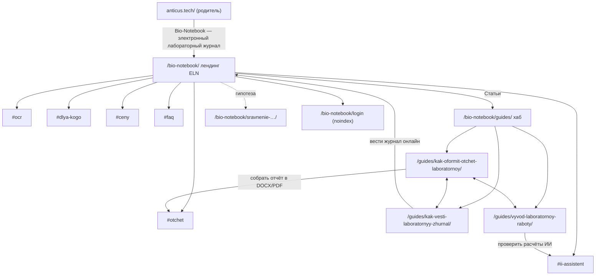

# План структуры Bio-Notebook — черновик для разработчика

Статус: **draft-awaiting-approval**. На сайте ничего не менялось и не публиковалось. Охват: только раздел `https://anticus.tech/bio-notebook/` (решение Артема 11.11.2026). Родительский сайт упоминается только там, где он влияет на журнал.

Источники:
- обход 11.11.2026 00:32–00:45 МСК: `raw/2026-11-11/crawl/` (36 URL, YandexBot + Chrome, DOM после JS) и таблица `wiki/syntheses/crawl-2026-11-11.csv`;
- Wordstat (`raw/2026-11-10/wordstat*`), ядро `wiki/queries/semantic-core-2026-11.csv`;
- топ-10 Яндекса, Москва, 10.11.2026 (`raw/2026-11-10/serp-yandex/`), матрица `serp-overlap-2026-11-10.md`, кластеры `keyword-clusters-2026-11.md`;
- быстрые проверки выдачи через WebSearch 11.11.2026. Это не Яндекс, только вторичный сигнал, помечен «инструмент (не Яндекс)».

Метки: видел / инструмент / вывод + уверенность. Частоты Wordstat не суммируются. P1 = 09.09–08.10.2026, P2 = 09.10–09.11.2026. Индексация отдельных URL в Вебмастере/GSC: **не проверено**.

---

## 1. Текущая карта раздела и проблемы

### 1.1 Дерево (что реально отвечает 11.11.2026)

```
anticus.tech/                         (родитель: ссылки «Цифра», «Электронный журнал Bio-Notebook», «начать бесплатный месяц»)
└── /bio-notebook/                    200 · лендинг · 731 слово в сыром HTML = 731 после JS (SSR, видел)
    ├── #ceny                         якорь блока цен (таблица 3 тарифов)
    ├── /guides/                      200 · хаб «Статьи» · 47 слов · 1 карточка
    │   └── /kak-oformit-otchet-laboratornoy/   200 · ЗАГЛУШКА 75 слов · в sitemap, index
    ├── /login                        500 (и ?mode=register — 500)
    ├── /register                     405 json, noindex (POST-эндпоинт)
    ├── /lab-admin                    200 noindex,nofollow (+Disallow)  ← /admin 301 сюда
    ├── /logout                       302 → /bio-notebook/ (x-robots noindex)
    ├── /pricing, /docs, /dashboard   302 → /login?error=LoginRequired → 500
    ├── /api/                         404 json noindex (+Disallow)
    ├── /static/og-image.png          200 image/png 109 382 байт
    └── всё прочее (/blog, /faq, /features, /ocr, /tarify, /privacy, /terms, /offer,
        /forgot-password, /index.html, /sitemap.xml, /robots.txt, /login/)  → 404 + noindex (корректно)
```

Отдельного sitemap и robots у журнала нет. Журнал живёт в общем `https://anticus.tech/sitemap.xml`: там 3 его URL (лендинг, хаб, заглушка), все с lastmod 2026-11-10. robots.txt общий для хоста (видел).

### 1.2 Проблемы по страницам

| URL | Проблема | Приоритет | Доказательство |
|---|---|---|---|
| `/bio-notebook/login`, `?mode=register` | 500 `text/plain` 21 байт. Сюда ведут все 6 CTA лендинга, CTA хаба и статьи, ссылка с главной. Через 302 сюда же уходят `/pricing`, `/docs`, `/dashboard` | Срочно (конверсия, не индексация) | видел, высокая |
| `/bio-notebook/guides/kak-oformit-otchet-laboratornoy/` | Заглушка 75 слов («Полная версия статьи готовится») в индексе и в sitemap. Нет H2, нет `<article>`, `<main>`, подвала. Автор: Organization «Команда Bio-Notebook», не связан с `#organization`. Нет publisher и image в Article, нет OG | Срочно (заменить готовым текстом `guide-otchet-po-laboratornoy-body.html`) | видел, высокая |
| `/bio-notebook/` | H1 «Ваш Лабораторный журнал.» без категории и бренда (title при этом верный) | Следующим (ТЗ refresh) | видел, высокая |
| `/bio-notebook/` | Отзывы «Алексей Иванов, Руководитель R&D лаборатории», «40% за 2 месяца» и «Мария Смирнова» всё ещё в HTML. Подлинность не подтверждена | Срочно (ТЗ refresh §11) | видел, высокая |
| `/bio-notebook/` | Опечатка в лиде: «**Введите** этапы, узлы, протоколы…». По смыслу должно быть «**Ведите**» (вывод) | Следующим | видел; смысл — вывод, средняя |
| `/bio-notebook/` | Иерархия заголовков: H2 «Из фото — в понятный отчёт» → **H4** «Лабораторная работа № 4» (элемент макета-демо) → H3. Заголовок в демо-картинке не должен быть Hn | Полезно | видел, высокая |
| `/bio-notebook/` | Нет `<header>` и `<main>`: 8 `<section>` без id, кроме `#ceny`. Первый `<nav>` без aria-label. Нет якорей для внутренних ссылок на сценарии | Следующим | видел, высокая |
| `/bio-notebook/` | В теле нет ссылки на статью и хаб: есть только «Статьи» в подвале | Следующим (после выкладки полного текста) | видел, высокая |
| `/bio-notebook/` | В `<head>` блокирующий `https://unpkg.com/lucide@latest`: внешний CDN, версия не закреплена. CSS Google Fonts подключён **дважды** одной строкой | Полезно (скорость/надёжность) | видел, высокая; влияние на CWV не измерено |
| `/bio-notebook/` | JSON-LD: Organization + WebSite + SoftwareApplication с AggregateOffer (0/379/0, offerCount 3) совпадает с таблицей `#ceny`. `description` в SoftwareApplication отличается от meta | Не трогать (верно); description сверить с one-liner после утверждения | видел, высокая |
| `/bio-notebook/guides/` | 47 слов, 1 карточка. Нет OG/Twitter, нет JSON-LD (видимые крошки есть, BreadcrumbList нет), нет `<main>`, нет подвала. Даты «2026-11-10» текстом, без `<time>` | Следующим | видел, высокая |
| `/bio-notebook/guides`, `/guides/kak-…-laboratornoy` (без слеша), `/bio-notebook//` | Отдают **200** той же страницы вместо 301. Canonical верный, дубль смягчён, но не закрыт | Следующим | видел, высокая |
| `https://www.anticus.tech/bio-notebook/` | 200, без редиректа на apex; canonical на apex | Следующим (по согласованию с хостом) | видел, высокая |
| Все страницы журнала | HEAD → **405** (лендинг, хаб, статья). Часть проверяльщиков и ботов использует HEAD | Следующим | видел, высокая |
| `/bio-notebook/?utm_source=…` | 200, canonical на чистый URL. Это нормально | Не трогать | видел, высокая |
| 404 журнала | 404 + `noindex` + `x-robots-tag`, своя страница «404 — страница не найдена · Bio-Notebook». Это корректно | Не трогать | видел, высокая |
| Метрика | Счётчика в сыром HTML трёх страниц нет (поиск `mc.yandex`, `ym(`). Отсутствие не доказано | уточнить у разработчика | видел, средняя |

Влияние родителя на журнал (видел): на главной 3 ссылки в журнал. Анкоры: «Цифра» (меню), «Электронный журнал Bio-Notebook» (карточка IT) и «начать бесплатный месяц» (последняя ведёт на 500). Organization `@id` `https://anticus.tech/#organization` в JSON-LD лендинга совпадает с главной, это правильно.

---

## 2. Целевая структура раздела

### 2.1 Принцип

Один продуктовый URL под коммерческий кластер c-eln, лендинг `/bio-notebook/`. Вокруг него хаб `/guides/` со статьями под информационные кластеры, где выдача Яндекса — гайды или методички, а не SaaS. Аудитории, функции, цены и FAQ делаем **секциями лендинга с якорями**, а не отдельными URL. Причина (гейт A, вывод): у этих тем либо нет измеренного спроса, либо выдача того же типа «страница SaaS», что и у лендинга. Отдельная страница отбирала бы у лендинга запрос «электронный лабораторный журнал».

### 2.2 Дерево (цель)

```
/bio-notebook/                                   лендинг ELN (c-eln) — существует
  #chto-takoe        Что такое электронный лабораторный журнал Bio-Notebook
  #ocr               OCR рукописных записей и фото приборов
  #otchet            Отчёт по лабораторной в DOCX/PDF
  #ii-assistent      ИИ-ассистент по эксперименту
  #dlya-kogo         Для студентов / преподавателей / лабораторий (+ кому выбрать другое)
  #sravnenie         Чем отличается от бумажного журнала и Word
  #ceny              Сколько стоит (таблица 3 тарифов) — существует
  #faq               FAQ (видимый <details>)
/bio-notebook/guides/                             хаб статей — существует
  /kak-oformit-otchet-laboratornoy/               c-report — существует (заглушка → полный текст)
  /kak-vesti-laboratornyy-zhurnal/                c-lab-journal-howto — новая, Следующим
  /vyvod-laboratornoy-raboty/                     c-vyvod — новая, Полезно (после первых двух)
/bio-notebook/sravnenie-elektronnyh-laboratornyh-zhurnalov/   гипотеза, Полезно (только после Wordstat)
/bio-notebook/login                               app, noindex (после починки 500)
```



### 2.3 Карточки страниц

#### P1. Лендинг `/bio-notebook/` — существует, refresh

- Кластер c-eln: «электронный лабораторный журнал» **170** (P1), «лабораторный журнал онлайн» 16 (P2), «учет экспериментов в лаборатории» 3 (P2). Источник: инструмент (Wordstat), высокая.
- Гейт B: страница SaaS-продукта **8/10**, это совпадение типа (вывод по снятому топ-10, высокая).
- Гейт A: конфликта нет. Других продуктовых URL у журнала нет.
- Приоритет: **Следующим**, тексты уже есть в `TZ-landing-refresh-eln-2026-11.md`.
- Title не менять: «Электронный лабораторный журнал с ИИ и OCR — Bio-Notebook».
- H1 из ТЗ refresh: «Электронный лабораторный журнал Bio-Notebook».
- Что добавить к ТЗ refresh этим планом:
  - `<section id>` с якорями из дерева 2.2, чтобы статьи ссылались на `#otchet`, `#ocr`, `#ii-assistent`;
  - контекстную ссылку из `#otchet` на статью об отчёте (только после выкладки полного текста);
  - в `#dlya-kogo` три подзаголовка H3: студентам, преподавателям и кафедрам, лабораториям. Условие из fact sheet: «отдельных тарифов для кафедр/групп нет»;
  - исправить «Введите» → «Ведите».
- Ссылки:
  - вход: главная («Bio-Notebook — электронный лабораторный журнал», см. п. 4.5), хаб, каждая статья;
  - выход: `#ceny`, хаб, статья об отчёте, login?mode=register.

#### P2. Хаб `/bio-notebook/guides/` — существует, доработка шаблона

- Кластер: свой запрос у хаба отсутствует. Это навигационная страница: hub ↔ spokes.
- Приоритет: **Следующим**.
- Title: «Статьи о лабораторном журнале и отчётах — Bio-Notebook» (сейчас «Статьи — электронный лабораторный журнал Bio-Notebook»). Ключ «электронный лабораторный журнал» с хаба лучше убрать, чтобы он не спорил с лендингом. Это de-optimize по гейту A, вывод.
- H1: «Статьи: отчёты, лабораторный журнал, протоколы».
- Структура:
  - лид 2 предложения;
  - карточки `<article>`: H2 со ссылкой, описание, `<time datetime>`;
  - блок «Попробовать Bio-Notebook»;
  - общий подвал.
- Пока статья одна, хаб тонкий (47 слов). Это допустимо, но **не добавлять** в хаб пустые «скоро» карточки.

#### P3. `/bio-notebook/guides/kak-oformit-otchet-laboratornoy/` — существует, заменить заглушку

- Кластер c-report. Главный запрос «отчет по лабораторной работе» **4538** (P1). Вторичные: «оформление отчета по лабораторной работе» 363, «отчет по лабораторной работе пример» 341, «шаблон отчета…» 157, «титульный лист…» 236, «как оформить отчет…» 114 (инструмент, высокая).
- Гейт B: вузовские методички PDF 6/10 + гайды 4/10. На «оформление отчета…» гайды 7/10. Вердикт Partial: наш тип «гайд» лидирует на вторичном запросе (вывод, высокая).
- Гейт A: конфликта нет.
- Приоритет: **Срочно**. Готовый текст лежит в `guide-otchet-po-laboratornoy-body.html` (3 658 слов, QA 38/40).
- Слаг не менять.
- Title из черновика: «Отчёт по лабораторной работе: структура, пример и шаблон». H1: «Как оформить отчёт по лабораторной работе».
- В эту же статью входят секции «Расчёты и погрешности» и «Как написать вывод (кратко)». Под «расчеты в лабораторной работе» (**1008**, P1) Яндекс-выдача не снималась. WebSearch 11.11 показывает вузовские PDF и гайды (инструмент (не Яндекс), низкая), поэтому отдельный URL не нужен.
- Ссылки:
  - вход: хаб, лендинг `#otchet`, P4, P5;
  - выход: лендинг `#otchet`, `#ceny`, P4, P5 (когда появятся).

#### P4. `/bio-notebook/guides/kak-vesti-laboratornyy-zhurnal/` — новая

- Кластер c-lab-journal-howto: «оформление лабораторного журнала» **177**, «лабораторные журналы требования к лабораторным журналам» 66, «как оформить лабораторный журнал» 44 (все P1, инструмент, высокая).
- Гейт B (Яндекс 10.11): вузовские методички PDF **7/10**, гайды 3/10 (linqo, studfile, zdrav). Вердикт Partial: страница-гайд попадает в лидирующую нишу гайдов, а не в PDF. Нейро уже цитирует методички КФУ, ТГУ и molpit (вывод, средняя).
- WebSearch 11.11 «как вести лабораторный журнал правила записи»: методички и правила (labx, expert123, СПбГУ, Капица-РАН). Инструмент (не Яндекс), средняя.
- Гейт A: с P3 пересечений 4+ нет (Q04 vs Q05 = 1 общий URL, видел матрицу). Интент другой: «как вести записи», а не «как оформить итоговый отчёт». Создавать.
- Приоритет: **Следующим** (после выкладки P3).
- Title: «Как вести лабораторный журнал: правила записей и пример».
- H1: «Как вести лабораторный журнал».
- Минимальный план H2:
  1. Ответ: что записывать в журнал каждый раз (список полей: дата, цель, материалы, условия, ход, сырые данные, исправления).
  2. Правила исправлений: зачеркнуть читаемо, дата, подпись. Только из открытых методичек, со ссылкой и датой проверки.
  3. Бумажный и электронный журнал: что меняется. Связь с лендингом `#sravnenie`, без «лучший».
  4. Пример записи одного опыта (таблица).
  5. Как перенести рукописные записи в электронный журнал (OCR). Связь с `#ocr`.
  6. FAQ (3–4 вопроса из выдачи).
- Не заявлять GLP/ГОСТ-соответствие Bio-Notebook: этого нет в fact sheet.
- Ссылки:
  - вход: хаб, P3, лендинг `#sravnenie`;
  - выход: лендинг `#ocr`, `#ceny`, P3.

#### P5. `/bio-notebook/guides/vyvod-laboratornoy-raboty/` — новая, позже

- Кластер c-vyvod: «вывод лабораторной работы» **50 345** (P1). Хвосты «…по физике» 8144, «…по химии» 2662 (инструмент, высокая). Спрос сильно размыт школьными хвостами «N класс». Те вынесены в c-school-vyvod и не цель.
- Гейт B: гайд/статья **9/10** (вывод, высокая). С c-report **0** общих URL. По правилу навыка это отдельная страница.
- Гейт A: с P3 конфликта нет. В P3 вывод только короткой секцией со ссылкой на P5.
- Коммерческая роль низкая. Вклад: охват студентов и упоминаемость бренда. Конверсия не измерена.
- Приоритет: **Полезно**. Делать после P3 и P4 и только при наличии реального автора. Тексты «примеры выводов» массово не генерировать.
- Title: «Вывод лабораторной работы: как написать и примеры».
- H1: «Как написать вывод к лабораторной работе».
- H2:
  1. Ответ из 3 частей: цель достигнута, ключевые результаты, оценка погрешности. Опора на методичку РХТУ (muctr.ru), видел в WebSearch.
  2. Шаблон фразы.
  3. 3 примера (физика, химия, биология; вуз, не школа).
  4. Частые ошибки.
  5. Как ИИ-чат Bio-Notebook проверяет расчёты до вывода (ссылка на `#ii-assistent`).
- Ссылки: вход из хаба и P3, выход на P3 и лендинг `#ii-assistent`.

#### P6. `/bio-notebook/sravnenie-elektronnyh-laboratornyh-zhurnalov/` — гипотеза

- Спрос на «сравнение / аналоги электронный лабораторный журнал» **не измерен**: в Wordstat такого seed нет.
- WebSearch 11.11 «сравнение электронных лабораторных журналов ELN аналоги Benchling российские»: каталог picktech.ru и страницы вендоров. У LabNote своя таблица «LabNote и альтернативы» (инструмент (не Яндекс), средняя).
- Гейт A: частично пересекается с лендингом (c-eln). Может отбирать запрос.
- Приоритет: **Полезно, условно**. Создавать только при трёх условиях:
  1. Wordstat по 3–5 seed («аналоги benchling», «сравнение электронных лабораторных журналов», «электронный лабораторный журнал для вуза») даёт спрос;
  2. Яндекс-топ показывает тип «сравнение/каталог»;
  3. факты конкурентов собраны с их страниц с датой.
- До этого сравнение «бумажный журнал / Word / Bio-Notebook» живёт секцией `#sravnenie` на лендинге (уже в ТЗ refresh).
- Черновые title/H1:
  - title: «Электронные лабораторные журналы: сравнение для вуза и лаборатории»;
  - H1: «Какой электронный лабораторный журнал выбрать».
- Вердикт на первом экране, у каждого варианта честный минус, Bio-Notebook с раскрытием «мы разработчик». Без «лучший».

### 2.4 Что НЕ создавать (и почему)

| Кандидат | Решение | Основание |
|---|---|---|
| `/bio-notebook/ocr/`, «распознавание рукописного текста» 1819 | Не трогать (секция `#ocr`) | онлайн-инструменты 9/10; мы не универсальный OCR (инструмент+вывод, высокая) |
| `/bio-notebook/ii-assistent/`, «нейросеть для лабораторных работ» 203 | Не создавать | сервисы «напишут работу» 7/10, чужой и этически спорный интент |
| `/bio-notebook/otchety-docx-pdf/` | Не создавать | дублирует P3 и `#otchet`, риск каннибализации c-report |
| `/bio-notebook/dlya-studentov/`, `/dlya-prepodavateley/`, `/dlya-laboratoriy/` | Не создавать, секция `#dlya-kogo` | спрос не измерен; WebSearch «ELN для вуза» = продуктовые страницы (LabNbook, OdanLab, ИРНИТУ), тот же тип, что лендинг → гейт A; отдельных тарифов для кафедр нет (fact sheet) |
| `/bio-notebook/tarify/` | Не создавать, `#ceny` | один платный тариф; брендовые запросы о цене закрывает лендинг; ИИ-движки уже читают цену с лендинга (GigaChat 10.11 — 379 ₽) |
| `/bio-notebook/faq/` | Не создавать | FAQ видимым блоком на лендинге и в статьях |
| `/bio-notebook/blog/` | Не создавать | хаб `/guides/` уже есть; два хаба = дубль |
| «презентация по лабораторной работе» 2442 (P2) | Пока не создавать | Яндекс-выдача не снята; WebSearch: смесь гайдов и сайтов-скачек школьных презентаций (инструмент (не Яндекс), низкая). Сначала снять топ-10 |
| «протокол эксперимента» 1565 | Не создавать | популярные строки про следственный эксперимент (c-investigative) |
| «лабораторный журнал» 5617, «журнал лабораторных работ» 1805 | Не создавать | маркетплейсы бумажных журналов и методички PDF |
| ЛИС 1775, медпротоколы 3340 | Не создавать | другой продукт |
| отдельная страница «шаблон/титульный лист отчёта» | Не создавать сейчас | 2 общих URL с seed c-report → та же статья P3; вернуться, если Вебмастер покажет отдельные показы |

---

## 3. Теги и разметка (по шаблонам Bio-Notebook)

### 3.1 HTML-правила, привязанные к увиденному

| Правило | Сейчас (видел 11.11) | Нужно |
|---|---|---|
| Один `<h1>` на страницу, с категорией | лендинг: 1 H1 «Ваш Лабораторный журнал.»; хаб: «Статьи»; статья: ок | H1 из карточек выше |
| H2 → H3 без пропусков | лендинг: H2 → **H4** (демо «Лабораторная работа № 4») | текст в макетах-демо делать `<p class>`/`<div>`, не Hn |
| `<header>` + `<nav aria-label="Основное">` | лендинг: `<nav class="hero-nav">` без aria-label, `<header>` нет | обернуть шапку в `<header>`, дать aria-label |
| `<main>` один на страницу | нет ни на одном шаблоне | `<main id="main">` вокруг контента в index.html, guides_index.html, guide_article.html |
| `<article>` для статьи | guide_article.html — нет; guides_index.html — `<article>` на карточку (ок) | `<article>` вокруг тела статьи; карточки хаба оставить |
| `<section id="…">` с одним H2 | 8 section, id только у `#ceny` | id по дереву 2.2 |
| `<footer>` с реквизитами на всех шаблонах | есть только на лендинге | общий подвал (ООО «Антикусь», ОГРН/ИНН, Статьи, юр. ссылки) в шаблоны хаба и статьи |
| Навигация только `<a href>` | все переходы — `<a href>` (ок); `onclick` только у кнопки cookies (ок) | так и оставить |
| `<button>` только для действий | 6 `<button>` — чипы демо ИИ и «Отправить», не навигация (ок) | ок; не делать кнопки-ссылки на /login |
| `` | 2 img партнёров: alt, 320×120, lazy (ок); макеты — CSS/HTML | новые скриншоты (экспорт DOCX, OCR) — `` с alt-описанием действия, width/height, lazy ниже первого экрана; первый экран — `fetchpriority="high"` без lazy |
| `<picture>`/WebP | нет; og-image.png 109 382 байт | скриншоты статей отдавать WebP + PNG-фолбэк через `<picture>` |
| `<time datetime>` для дат | хаб и статья: «2026-11-10» простым текстом | `<time datetime="2026-11-10">10 ноября 2026</time>` |
| `<table>` для цен | `#ceny` — настоящая `<table>` (ок); вторая таблица — демо ОД600 (ок) | оставить; добавить `<caption>` «Тарифы Bio-Notebook, ₽, НДС не облагается, на <дата>» |
| FAQ — видимый `<details><summary>` | `<details>` нет нигде | `<details>` FAQ на лендинге (ТЗ refresh §12) и в статьях |
| Хлебные крошки `<nav aria-label>` + `<ol>` | хаб/статья: `<nav class="crumbs" aria-label="Хлебные крошки">` со стрелками «→» текстом | перейти на `<ol>` (стрелки через CSS), последний пункт `aria-current="page"`; на лендинге крошки не нужны |
| `lang="ru"` | есть везде (ок) | оставить; hreflang не нужен (одна языковая версия) |

### 3.2 Meta: использовать / убрать

Использовать на каждом индексируемом шаблоне:
- `<title>` (уникальный, ≤60 символов, бренд в конце);
- `meta description` (уникальный);
- `link rel=canonical`, абсолютный, со слешем;
- `meta robots` `index, follow, max-image-preview:large`;
- OG: `og:type` (website, а для статей article), `og:title`, `og:description`, `og:url`, `og:image` 1200×630 и `og:image:alt`, `og:locale ru_RU`, `og:site_name Bio-Notebook`;
- `twitter:card summary_large_image`;
- для статей `article:published_time` и `article:modified_time`.

Сейчас OG и Twitter есть только на лендинге (10 + 4 тега), на хабе и статье **0** (видел).

Не использовать или убрать:
- `meta keywords` — сейчас нет, не добавлять;
- скрытый текст и блоки «для роботов» (`aria-hidden`, 1 px, `clip`) — в журнале не найдено, не вводить;
- отдельные версии для ботов — HTML YandexBot = Chrome побайтово на всех 36 URL (видел);
- `AggregateRating` и `Review` без реальных отзывов;
- имена и цифры из непроверенных отзывов;
- SearchAction (поиска в журнале нет);
- LocalBusiness;
- дублирующий Organization с другим именем: везде `@id https://anticus.tech/#organization`, имя «Антикусь»;
- `foundingDate` — не указывать, решение Артема;
- `sameAs` — только `https://github.com/RockInMyHead/biobook`;
- noindex на юр. ссылки с лендинга не вешать, их индексация — дело родителя.

### 3.3 JSON-LD по шаблонам (один `@graph`, стабильные `@id`)

| Шаблон | Типы | Обязательные поля | Сейчас |
|---|---|---|---|
| `index.html` (лендинг) | Organization (ссылкой или кратко, тот же `@id`), WebSite `@id https://anticus.tech/#website`, SoftwareApplication `#software` с AggregateOffer, FAQPage — только когда видимый FAQ выложен | offers = таблица `#ceny` (0 ₽ пробный, 379 ₽/мес, 0 ₽ бесплатный); description = утверждённый one-liner | Organization + WebSite + SoftwareApplication (видел), FAQPage нет — верно, FAQ не выложен |
| `guides_index.html` (хаб) | CollectionPage `#webpage` (isPartOf `#website`), BreadcrumbList, ItemList статей | url, name, itemListElement с url статей | JSON-LD **нет** |
| `guide_article.html` (статья) | Article (или HowTo не нужен), BreadcrumbList, FAQPage только при видимом FAQ | headline = H1; datePublished/dateModified = видимые `<time>`; author — реальный человек (Person, name, jobTitle) — [уточнить: автор]; publisher `{"@id":"https://anticus.tech/#organization"}`; image; mainEntityOfPage; about → `#software` | Article + BreadcrumbList; author Organization «Команда Bio-Notebook», нет publisher и image |
| `/login` | нет | — | нет (ок) |
| 404 | нет | — | нет (ок) |

Валидация: Вебмастер → Валидатор микроразметки и Rich Results Test. Значения разметки должны совпадать с видимым текстом.

---

## 4. Техника

### 4.1 Рендер

Bio-Notebook — серверный HTML Starlette. Число слов в сыром HTML равно числу после выполнения JS (731/731, 47/47, 75/75; headless Chrome, видел). Пререндер для журнала **не нужен**. Правило для новых шаблонов: весь текст, цены, FAQ и ссылки отдаются в HTML-ответе, не подгружаются через fetch. Скрытого текста в журнале нет (поиск `aria-hidden="true"` дал 0, видел).

### 4.2 Коды и 301-карта

| Откуда | Сейчас | Нужно |
|---|---|---|
| `/bio-notebook` | 301 → `/bio-notebook/` | ок |
| `/bio-notebook/guides` | 200 | 301 → `/bio-notebook/guides/` |
| `/bio-notebook/guides/<slug>` (без слеша) | 200 | 301 → `/bio-notebook/guides/<slug>/` |
| `/bio-notebook//` и любые `//` | 200 | 301 на путь с одинарным слешем |
| `https://www.anticus.tech/bio-notebook/*` | 200 | 301 → `https://anticus.tech/bio-notebook/*` (правило nginx уровня хоста, согласовать) |
| `/bio-notebook/login/` | 404 | можно 301 → `/bio-notebook/login` (Полезно) |
| `/bio-notebook/admin` | 301 → `/lab-admin` (noindex) | ок |
| HEAD на любой GET-маршрут | 405 | 200/301/404 как у GET (Starlette: `methods=["GET","HEAD"]` или middleware) |
| несуществующие пути | 404 + noindex | ок |

### 4.3 sitemap.xml (общий файл хоста, раздел журнала)

- Включать только 200-канонические индексируемые URL со слешем: `/bio-notebook/`, `/bio-notebook/guides/` и каждую статью **с полным текстом**.
- Заглушку исключить, пока её не заменили. Если полный текст выкладывается сразу, оставить URL с новым lastmod.
- `lastmod` = дата реального изменения контента страницы, не дата деплоя. `changefreq` и `priority` Яндекс и Google не используют, их можно не выводить.
- Не включать: `/login`, `?mode=register`, `/lab-admin`, `/logout`, `/register`, `/api/`, `/static/`.
- Генерировать раздел журнала из списка статей в `app.py`, чтобы новая статья попадала в sitemap автоматически.

### 4.4 robots.txt (общий)

Текущие Disallow журнала (`/bio-notebook/api/`, `/admin`, `/lab-admin`, `/auth/`, `/invite`, `/share/`, `/static/uploads/`) — **не трогать**. Предложение «Полезно»: `Disallow: /bio-notebook/logout`. ИИ-ботов не закрывать (YandexAdditional и прочие открыты через `*`).

### 4.5 Внутренние ссылки, навигация, подвал

| Источник | Цель | Анкор | Статус |
|---|---|---|---|
| главная anticus.tech (меню) | `/bio-notebook/` | «Bio-Notebook» вместо «Цифра» | в ТЗ главной, связано с журналом |
| главная (карточка IT) | `/bio-notebook/` | «Электронный журнал Bio-Notebook» | есть, ок |
| главная | `/bio-notebook/login?mode=register` | «начать бесплатный месяц» | ведёт на 500 — после починки ок |
| лендинг `#otchet` | P3 | «как оформить отчёт по лабораторной работе» | добавить после выкладки P3 |
| лендинг шапка | `/bio-notebook/guides/` | «Статьи» | добавить в `<nav>` шапки (сейчас только подвал) |
| хаб | каждая статья | H2-заголовок статьи | есть |
| P3 | лендинг `#otchet` | «собрать отчёт в DOCX и PDF в Bio-Notebook» | в черновике гайда |
| P3 ↔ P4 ↔ P5 | друг на друга | описательные, разные | при создании |
| статья/хаб | `/bio-notebook/` | «Bio-Notebook» (крошки) + контекст | есть крошки |

Меню шапки на всех шаблонах журнала:
- Bio-Notebook (лендинг);
- Возможности (`/#ocr`);
- Цены (`/#ceny`);
- Статьи;
- Вход;
- кнопка «Месяц бесплатно».

Подвал на всех шаблонах:
- реквизиты ООО «Антикусь»;
- Статьи;
- юр. ссылки родителя со слешем (`/privacy/` и т.д., сейчас без слеша → 301);
- «Антикусь» → `https://anticus.tech/`.

Глубина: все страницы журнала доступны за ≤2 клика от лендинга. Сирот нет: заглушка доступна из хаба.

---

## 5. Дорожная карта с приёмкой

### Срочно

1. Починить `/bio-notebook/login` (500). Приёмка: `curl -s -o /dev/null -w '%{http_code}' https://anticus.tech/bio-notebook/login` → `200`; то же для `?mode=register`; `/bio-notebook/pricing` → 302 → 200.
2. Заменить заглушку P3 полным текстом (`guide-otchet-po-laboratornoy-body.html`) и шаблон статьи по 3.1/3.3. Приёмка:
   - `curl -s URL | python3 -c "import sys,re;print(len(re.findall(r'\w+',re.sub('<[^>]+>',' ',sys.stdin.read()))))"` → ≥3000;
   - `grep -c '<h2'` ≥ 6;
   - `grep -c 'Полная версия статьи готовится'` = 0;
   - `grep -c '"publisher"'` ≥ 1;
   - `grep -c 'og:title'` = 1.
3. Снять отзывы и «40%» с лендинга (ТЗ refresh §11). Приёмка: `curl -s https://anticus.tech/bio-notebook/ | grep -cE 'Иванов|Смирнова|40%'` → `0`.

### Следующим

4. ТЗ refresh лендинга: H1, секции с id, `<header>`/`<main>`, «Ведите», FAQ `<details>`, ссылка на P3. Приёмка:
   - `grep -o '<h1[^>]*>[^<]*' | grep -c 'Электронный лабораторный журнал'` = 1;
   - `grep -cE 'id="(ocr|otchet|ii-assistent|dlya-kogo|ceny|faq)"'` = 6;
   - `grep -c '<main'` = 1;
   - `grep -c '<h4'` = 0;
   - `grep -c 'Введите этапы'` = 0.
5. Шаблоны хаба и статьи: `<main>`, `<article>`, `<time>`, общий подвал, OG/Twitter, JSON-LD хаба. Приёмка: на `/guides/` `grep -c 'og:title'` = 1, `grep -c 'CollectionPage'` = 1, `grep -c '<time datetime'` ≥ 1, `grep -c 'ОГРН'` = 1.
6. 301 для слеша/двойного слеша и HEAD. Приёмка:
   - `curl -s -o /dev/null -w '%{http_code} %{redirect_url}' https://anticus.tech/bio-notebook/guides` → `301 https://anticus.tech/bio-notebook/guides/`;
   - `curl -sI https://anticus.tech/bio-notebook/ | head -1` → `HTTP/1.1 200`.
7. www → apex (если согласовано). Приёмка: `curl -sI https://www.anticus.tech/bio-notebook/ | grep -i '^location'` → `https://anticus.tech/bio-notebook/`.
8. P4 «Как вести лабораторный журнал»: BRIEF → тексты → QA по навыку, отдельное согласование.

### Полезно

9. Убрать `unpkg.com/lucide@latest` (локальные иконки или закреплённая версия с `defer`) и дубль Google Fonts. Приёмка: `grep -c 'lucide@latest'` = 0, `grep -c 'fonts.googleapis.com/css2'` = 1.
10. Крошки на `<ol>` и `aria-current`, `<caption>` у таблицы цен, WebP для скриншотов.
11. P5 «Вывод лабораторной работы» — после P3/P4 и с реальным автором.
12. P6 сравнение — только после Wordstat + Яндекс-топ по seed из 2.3.
13. Снять Яндекс-топ «презентация по лабораторной работе» и решить по гейту B.

### Не трогать

- Disallow журнала в robots.txt.
- 404 + noindex для несуществующих путей.
- Canonical с UTM на чистый URL.
- AggregateOffer (совпадает с ценами).
- Title лендинга.
- Слаг статьи об отчёте.
- Отсутствие пререндера: журнал и так SSR.
- llms.txt.

После выкладки пунктов 1–3: переобход в Вебмастере для `/bio-notebook/`, `/bio-notebook/guides/` и статьи (делает Артем).

## Что нужно от Артема (минимум)

1. Утвердить этот план (draft-awaiting-approval).
2. Автор статьи P3: имя и роль для Person в Article. Без автора остаётся Organization, это допустимо, но слабее.
3. Разрешение снять отзывы (ТЗ refresh §11), если ещё не дано.
